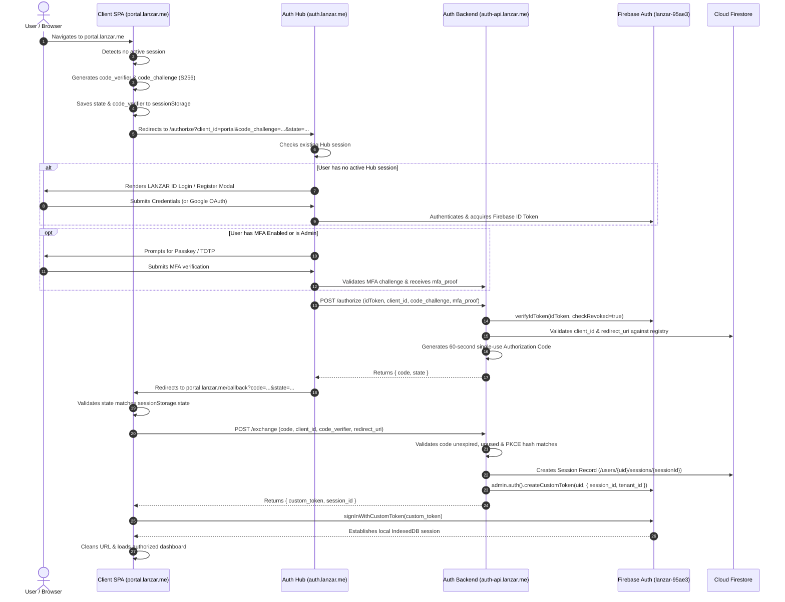
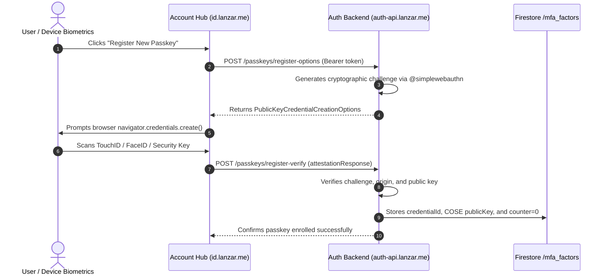
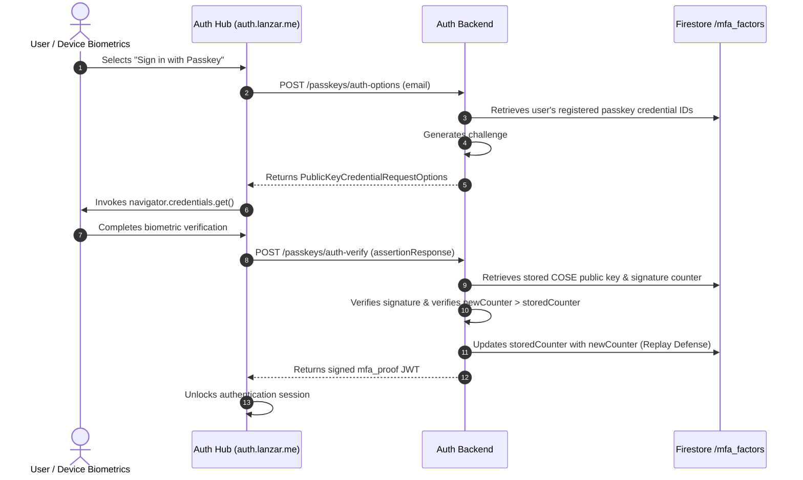
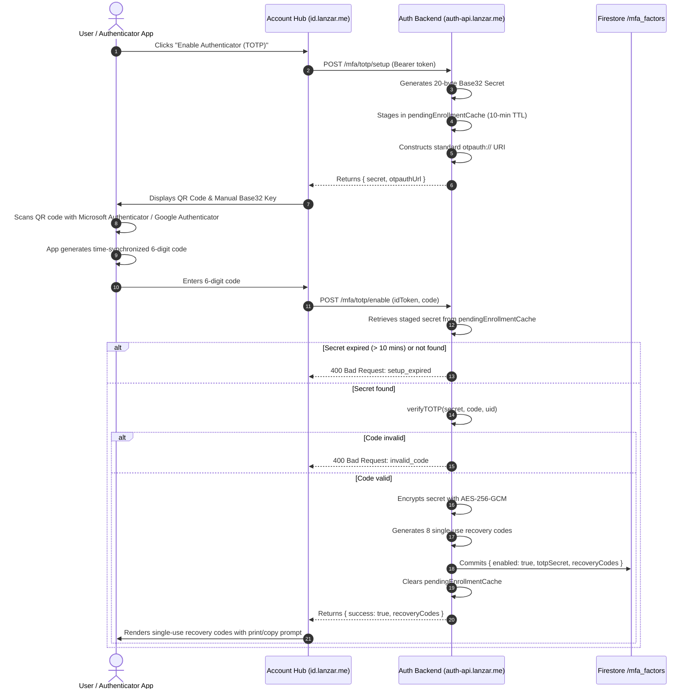
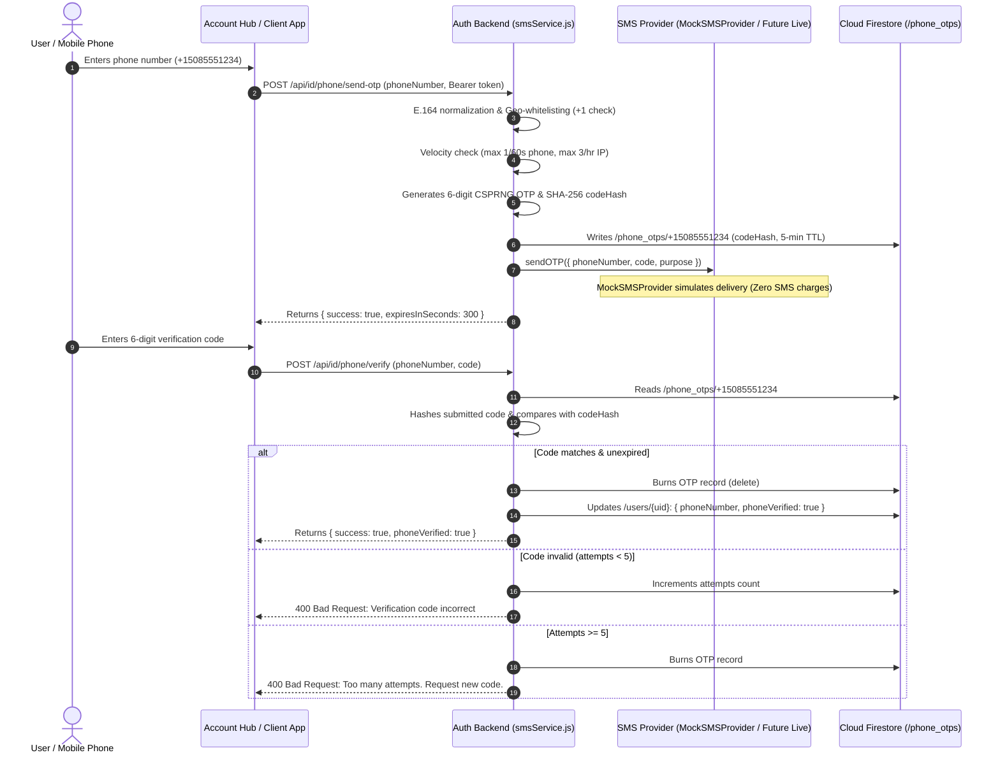
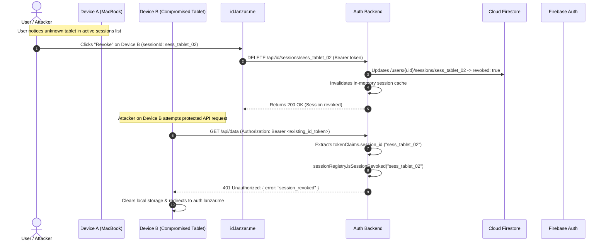

# LANZAR ID — Authentication & Authorization Sequence Flows
**Document ID:** LID-FLOW-005  
**Classification:** Confidential — Internal Master Architecture Directive  
**Status:** Authoritative Baseline (Phase 1 Approved)  
**Date:** November 8, 2026  
**Author:** Larry (Lead Systems Architect)  

---

## 1. Primary OAuth 2.0 / PKCE Flow with Custom Token Exchange

This sequence illustrates an unauthenticated user accessing an ecosystem client (e.g., `portal.lanzar.me`), authenticating at the central Hub (`auth.lanzar.me`), and establishing a secure local session.



---

## 2. Mandatory Email Verification Workflow

```mermaid
sequenceDiagram
    autonumber
    actor User as User / Browser
    participant Client as Ecosystem App (Pythos / Portal)
    participant AuthHub as auth.lanzar.me
    participant Firebase as Firebase Auth
    participant Mail as Email Service (Firebase Pipe)

    User->>AuthHub: Registers new account (email + password)
    AuthHub->>Firebase: createUser({ email, password })
    Firebase->>Mail: Dispatches verification email with cryptographically signed action link
    AuthHub-->>User: "Verification email sent. Please check your inbox."

    User->>Client: Attempts to open protected services
    Client->>Client: Inspects user.emailVerified
    alt emailVerified === false
        Client->>User: Displays persistent warning banner: "Email unverified"
        Client->>Client: Restricts access to paid/sensitive features
    end

    User->>Mail: Opens email & clicks verification link
    Mail->>Firebase: Processes oobCode & updates account to emailVerified=true
    Firebase-->>User: Confirms verification success in browser

    User->>Client: Refreshes application
    Client->>Firebase: user.getIdToken(/* forceRefresh */ true)
    Firebase-->>Client: Returns ID Token with email_verified: true
    Client->>User: Banner disappears; full ecosystem access unlocked
```

---

## 3. FIDO2 / WebAuthn Passkey Ceremony

### 3.1 Passkey Registration (Enrollment)


### 3.2 Passkey Authentication (Login)


---

## 5. Universal TOTP Authenticator Enrollment & Verification (Amendment #001)

This flow details the universal RFC 6238 enrollment ceremony compatible with **Microsoft Authenticator**, **Google Authenticator**, **1Password**, and compliant TOTP applications.



---

## 7. Phone Authentication & Verification Sequence (Amendment #002)




