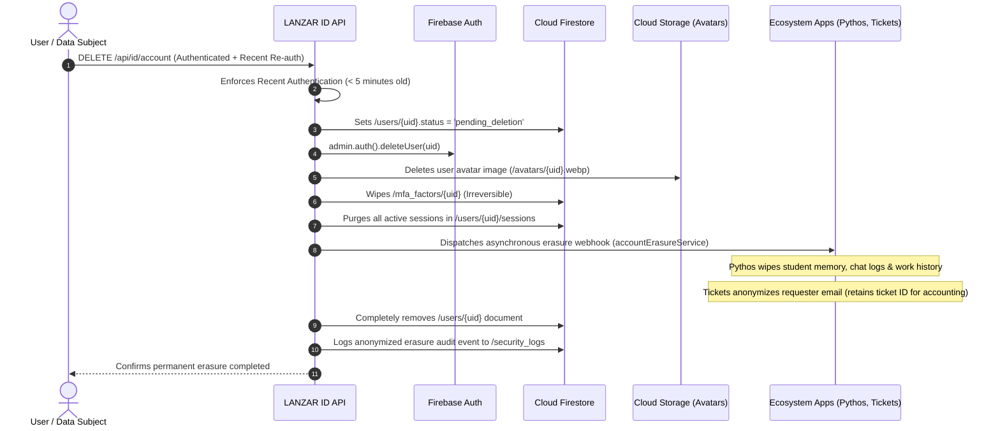

# LANZAR ID — Data Retention, Privacy & Account Erasure Policy
**Document ID:** LID-PRIV-011  
**Classification:** Confidential — Internal Master Policy  
**Status:** Authoritative Baseline (Phase 1 Approved)  
**Date:** November 8, 2026  
**Author:** Larry (Lead Systems Architect)  

---

## 1. Privacy Mandate & Regulatory Compliance

LANZAR ID enforces data minimization and strict retention policies in compliance with the General Data Protection Regulation (GDPR), California Consumer Privacy Act (CCPA), and applicable student privacy frameworks (COPPA/FERPA) governing educational applications like Pythos.

---

## 2. Retention Schedules by Data Classification

| Collection / Data Entity | Retention Period | Deletion / Archival Mechanism |
| :--- | :--- | :--- |
| **Global Profiles (`/users`)** | Retained while account is active. | Hard-deleted or anonymized upon user erasure request. |
| **MFA Credentials (`/mfa_factors`)** | Retained while MFA is active. | Immediately wiped upon user erasure or factor de-enrollment. |
| **Active Sessions (`/sessions`)** | Active until revoked or expired. | Auto-purged 90 days after revocation or expiration via TTL policy. |
| **Auth Codes (In-Memory / Cache)**| 60 seconds. | Instant invalidation upon consumption or automatic TTL eviction. |
| **Phone OTP Tokens (`/phone_otps`)**| 5 minutes. | Purged immediately upon verification or 15-minute TTL eviction. |
| **Founder Records (`/founders`)** | Permanent (Honorary). | Preserved indefinitely unless explicitly revoked or account erased. |
| **Product Entitlements** | Active for subscription duration. | Archived upon expiration; historical billing records retained in Stripe. |
| **Security Audit Logs (`/security_logs`)**| **365 days (Immutable WORM).** | Retained for 1 year in Cloud Storage bucket with Object Retention Lock. |

---

## 3. Account Erasure & "Right to be Forgotten" Workflow

When a user executes `DELETE /api/id/account` or submits an administrative erasure request through Portal Mission Control:

### 3.1 Accounting & Legal Hold Exceptions
In accordance with tax and financial compliance regulations:
* Stripe customer IDs and historical payment records in billing databases are retained in anonymized form for 7 years.
* Ticket communication histories are stripped of personal identifying details (name, email, phone) but retain operational case transcripts for organizational support metrics.

---

## 4. Disaster Recovery & Independent Backup Schedules

To safeguard against catastrophic failure, ransomware, or accidental corruption:
1. **Daily Managed Firestore Export:** A Cloud Scheduler cron triggers a managed export of all Firestore collections to an isolated Google Cloud Storage bucket (`gs://lanzar-firestore-backups/`).
2. **Geographic Redundancy:** Backups are replicated across multi-region US storage.
3. **Immutability Lock:** Backup buckets are protected with a 30-day GCP Bucket Lock policy preventing manual deletion or overwrites.
4. **Restoration Drills:** A monthly automated test job restores the previous day's backup into an isolated staging environment and runs automated schema validation checks.
