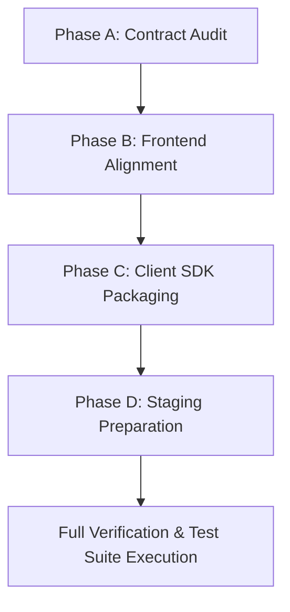

# LANZAR ID — Master Contract Audit & Implementation Plan

**Milestone:** Phase A Contract Audit  
**Target Architecture:** Single Central Auth Hub (`auth.lanzar.me`), Ecosystem Services (`portal.lanzar.me`, `tickets.lanzar.me`, `threadline.lanzar.me`, `ai.lanzar.me`, `pythos.lanzar.me`)  
**Status:** Audit Complete — Moving to Implementation  

---

## 1. Executive Summary & Architectural Invariant

Per explicit architecture directives:
- **`auth.lanzar.me`** is the **sole** identity provider, authentication service, and account management hub for the LANZAR ecosystem.
- **There is no `id.lanzar.me` subdomain.** All prior assumptions, code references, or host matching for `id.lanzar.me` are excised. Account management is accessed via `/account` or `?view=account` on `auth.lanzar.me`.
- The customer portal is **`portal.lanzar.me`** (`client_id: 'portal'`).
- The client applications in the LANZAR ecosystem are:
  1. `portal.lanzar.me` (`portal`)
  2. `tickets.lanzar.me` (`tickets`)
  3. `threadline.lanzar.me` (`threadline`)
  4. `ai.lanzar.me` (`ai`)
  5. `pythos.lanzar.me` (`pythos`)
  6. `lanzar.me` (`mothership`)

---

## 2. Component Contract Audit

### 2.1 Backend Contract Status (`auth/auth-backend`)
| Endpoint | Method | Status | Notes |
| :--- | :--- | :--- | :--- |
| `/authorize` | `POST` | Verified | Enforces strict PKCE (`code_challenge_method === 'S256'`), rejects downgrades, triggers MFA challenge (403 `mfa_required`) if admin or enrolled. |
| `/exchange` | `POST` | Verified | Verifies SHA-256 PKCE challenge against `code_verifier`, executes atomic CAS code invalidation (`store.js`), mints custom token with session claims. |
| `/mfa/totp/setup` | `POST` | Verified | Generates Base32 TOTP secret and `otpauth://` URI. |
| `/mfa/totp/enable` | `POST` | Verified | Validates 6-digit TOTP code, enables factor, generates 8 single-use recovery codes. |
| `/mfa/verify` | `POST` | Verified | Verifies 6-digit TOTP or 10-char recovery code, generates signed `mfaProof` (10m TTL). |
| `/api/id/profile` | `GET`/`PUT`| Verified | Profile updates restricted strictly to `displayName`, `bio`, and `avatarUrl` (HTTPS). |
| `/api/id/sessions` | `GET` | Verified | Lists active device sessions with IP, user agent, timestamps. |
| `/api/id/sessions/:id` | `DELETE`| Verified | Revokes single device session document in Firestore. |
| `/api/id/sessions/revoke-all` | `POST` | Verified | Revokes all active sessions for user, increments token version. |

### 2.2 React Frontend Integration Gaps (`auth/src`)
1. **Hardcoded API URLs:** `App.jsx`, `Login.jsx`, and `MyLanzarAccount.jsx` contain `window.location.hostname === 'localhost' ? 'http://localhost:4001' : 'https://auth-api.lanzar.me'`. In staging (`auth-dev.lanzar.me`), this mistakenly sends traffic to the production API.
   - *Fix:* Create centralized `auth/src/config/env.js` that detects dev, staging (`auth-dev.lanzar.me`), and prod, and honors `VITE_AUTH_API_URL`.
2. **`id.lanzar.me` Domain Reference:** `App.jsx` line 31 checks `window.location.hostname === 'id.lanzar.me'`.
   - *Fix:* Excise this check. Account management is resolved strictly via `/account` path, `?view=account` query, or authenticated user outside OAuth flow.
3. **PKCE Validation in `App.jsx`:** When `isOAuthFlow` is active, missing `code_challenge` or missing/non-S256 `code_challenge_method` was falling back to `'default_challenge'` / `'S256'`.
   - *Fix:* Require explicit PKCE parameters in `App.jsx`. If `code_challenge` is absent or `code_challenge_method !== 'S256'`, display immediate security alert and reject authorization flow without contacting backend.
4. **MFA Secret & Recovery Code Display:** Verify visual rendering of Base32 secret, QR code compatibility, and 8-grid recovery code pills.

### 2.3 Client SDK Contract Gaps (`auth/src/sdk/lanzar-auth-modal.js`)
1. **PKCE Helpers Missing:** Currently the SDK opens an iframe but does not provide cryptographically secure client-side PKCE generation (`code_verifier`, SHA-256 `code_challenge`) or code-for-token exchange.
   - *Fix:* Implement `LanzarAuth.generatePkceCodes()` (RFC 7636 compliant, base64url, cryptographically strong random values) and `LanzarAuth.exchangeCode()`.
2. **Continuation URL Allowlist:** Align allowlist to ecosystem services: `portal.lanzar.me`, `tickets.lanzar.me`, `threadline.lanzar.me`, `ai.lanzar.me`, `pythos.lanzar.me`.
3. **PostMessage & Popup Handshake:** Support bidirectional handshake for modal/popup authentication with strict origin validation.

---

## 3. Coordinated Execution Plan

### Phase B: Frontend Alignment
- [x] Create `auth/src/config/env.js` for environment-aware API URL and Hub URL resolution.
- [x] Update `auth/src/App.jsx`:
  - Remove all `id.lanzar.me` references.
  - Enforce explicit `code_challenge` and `code_challenge_method === 'S256'`.
  - Use `auth/src/config/env.js`.
- [x] Update `auth/src/pages/Login.jsx` to use environment config and verify MFA enrollment/verification.
- [x] Update `auth/src/components/MyLanzarAccount.jsx` to use environment config.
- [x] Validate frontend bundle (`npm run build`).

### Phase C: Client SDK Packaging & Validation
- [x] Extend `auth/src/sdk/lanzar-auth-modal.js`:
  - Add cryptographic PKCE generator (`generatePkcePair()`).
  - Add OAuth authorize URL builder with explicit S256 PKCE.
  - Add exchange helper (`exchangeCodeForSession()`).
  - Add postMessage handshake handler with origin validation.
- [x] Create automated SDK contract test suite: `auth/test-sdk-contract.cjs`.
- [x] Verify integration tests across Portal, Tickets, Pythos client scopes.

### Phase D: Staging Deployment Preparation
- [x] Verify staging configuration matrix in `auth-backend/config/environments.js`.
- [x] Create `auth/test-staging-bootstrap.cjs` validating `APP_ENV=staging` bootstrap safeguards.
- [x] Author `_docs/auth/LANZAR_ID_STAGING_SECRETS_CHECKLIST.md`.
- [x] Author `_docs/auth/LANZAR_ID_STAGING_DEPLOYMENT_RUNBOOK.md`.

### Final Acceptance
- [x] Run all 5 backend regression suites + new SDK contract suite + new Staging bootstrap test suite.
- [x] Verify 100% test pass rate across all suites.
