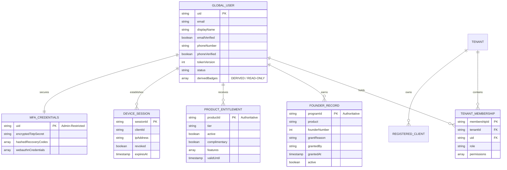

# LANZAR ID — Profile Schema & Identity Data Architecture
**Document ID:** LID-SCHEMA-002  
**Classification:** Confidential — Internal Master Architecture Directive  
**Status:** Authoritative Baseline (Phase 1 Approved)  
**Date:** November 8, 2026  
**Author:** Larry (Lead Systems Architect)  

---

## 1. Overview & Data Isolation Mandate

The LANZAR ID identity datastore is hosted in Cloud Firestore (Project: `lanzar-95ae3`). To ensure high performance, prevent data corruption, and enforce the principle of least privilege, identity data is decomposed into discrete, strictly bounded collections.

### 1.1 Golden Rules of the Data Architecture
1. **Derived Summary Invariant:** The global profile (`/users/{uid}`) contains only basic user identity attributes and **read-only, derived summaries** of founder designations and roles. The authoritative source of truth for Founder Programs resides exclusively in the sub-collection `/users/{uid}/founders/{programId}`. No API endpoint may mutate profile-level badges directly.
2. **Separation of Entitlements and Recognition:** Founder designations (honorary/lifetime badges) and product entitlements (service tier, quota, feature flags) are stored and managed independently. A founder designation does not inherently confer complimentary enterprise access unless explicitly granted in entitlements.
3. **Strict Credential Isolation:** Passwords and password hashes are never stored in Firestore. MFA secrets (TOTP base32 keys, recovery code hashes, WebAuthn public key credentials) are stored in an isolated, admin-restricted collection (`/mfa_factors/{uid}`) and are never serialized in administrative API responses.
4. **Tenant Scoping:** Every membership, registered client, session, and audit record carries a mandatory `tenant_id`.

---

## 2. Entity Relationship Overview



---

## 3. Detailed Collection Schemas

### 3.1 Global Identity Profile (`/users/{uid}`)
Represents the user's universal human identity across the ecosystem.

```typescript
interface GlobalUserProfile {
  uid: string;                      // Permanent unique ID (e.g. Firebase Auth UID: "usr_9a8b7c6d5e")
  tenantId: string;                 // Home tenant (Default: "lanzar")
  email: string;                    // Normalized lowercase email (e.g. "alex@example.com")
  emailVerified: boolean;           // Verified status from Firebase Auth
  phoneNumber: string | null;       // Normalized E.164 phone (e.g. "+15085551234")
  phoneVerified: boolean;           // Explicit phone verification status
  displayName: string;              // User-chosen public display name (e.g. "Alex Vance")
  bio: string;                      // Optional short bio (max 280 chars)
  avatar: {
    type: 'upload' | 'google' | 'gravatar' | 'default';
    url: string;                    // Public HTTPS URL (Google Cloud Storage or provider CDN)
    updatedAt: string;              // ISO-8601 UTC timestamp
  };
  role: 'user' | 'admin' | 'service'; // Baseline ecosystem role
  status: 'active' | 'suspended' | 'pending_deletion';
  tokenVersion: number;             // Global session invalidation counter (Monotonically increasing integer)
  
  // DERIVED READ-ONLY FIELDS (Calculated exclusively by backend server or Cloud Function)
  // Under NO circumstances can these arrays be written directly by client or admin PUT requests.
  derivedBadges: string[];          // e.g. ["lanzar_id_founder", "pythos_founder"]
  derivedEntitlements: Record<string, string>; // e.g. { "pythos": "pro", "portal": "enterprise" }

  metadata: {
    createdAt: string;              // ISO-8601 UTC timestamp
    updatedAt: string;              // ISO-8601 UTC timestamp
    lastLoginAt: string;            // ISO-8601 UTC timestamp
    lastLoginIp: string;            // Anonymized client IP
  };
}
```

---

### 3.2 Product-Specific Founder Records (`/users/{uid}/founders/{programId}`)
**AUTHORITATIVE SOURCE OF TRUTH.** Each document represents an independent, product-scoped Founder designation.

```typescript
interface AuthoritativeFounderRecord {
  programId: string;                // Document ID: "lanzar_id_founder" | "pythos_founder" | "portal_founder" | "traveling_founder" | "threadline_founder"
  product: 'lanzar_id' | 'pythos' | 'portal' | 'traveling' | 'threadline';
  founderNumber: number;            // Sequential founder sequence number (e.g. 104)
  title: string;                    // Display title (e.g. "Pythos Founding Scholar")
  active: boolean;                  // True if designation is in good standing
  badgeIconUrl: string;             // Asset path for badge icon
  grantReason: string;              // Mandatory administrative audit reason
  grantedBy: string;                // Admin UID who approved the designation
  grantedAt: string;                // ISO-8601 UTC timestamp
  revokedAt: string | null;         // Null unless revoked
  revokedBy: string | null;         // Null unless revoked
  revocationReason: string | null;  // Mandatory if revoked
}
```

*Synchronization Invariant:* Whenever a document in `/users/{uid}/founders/` is created, updated, or soft-deleted, the backend service recalculates the user's `derivedBadges` array and persists it atomically onto `/users/{uid}`.

---

### 3.3 Product Entitlements (`/users/{uid}/entitlements/{productId}`)
**AUTHORITATIVE SOURCE OF TRUTH.** Governs service tiers, capabilities, and quotas.

```typescript
interface AuthoritativeProductEntitlement {
  productId: string;                // Document ID: "pythos" | "portal" | "tickets" | "threadline"
  tier: 'free' | 'student' | 'pro' | 'enterprise_managed';
  active: boolean;                  // Entitlement active status
  complimentary: boolean;           // True if granted as an honorary/promotional perk
  assignedBy: string;               // Admin UID or 'system_stripe_webhook'
  assignedAt: string;               // ISO-8601 UTC timestamp
  validUntil: string | null;        // ISO-8601 UTC timestamp (null = lifetime/no expiration)
  features: string[];               // Specific feature flags (e.g. ["deterministic_engine", "priority_queue"])
  rateLimitMultiplier: number;      // API rate limit modifier (Default: 1.0)
}
```

---

### 3.4 Multi-Tenant Organization Memberships (`/memberships/{tenantId_uid}`)
Enforces organization boundaries for current and future commercial IDaaS usage.

```typescript
interface TenantMembership {
  membershipId: string;             // Document ID: `${tenantId}_${uid}`
  tenantId: string;                 // Target Organization ID (e.g. "lanzar" or "acme_saas")
  uid: string;                      // Reference to /users/{uid}
  orgDisplayName: string;           // Organization name cache
  role: 'member' | 'admin' | 'owner';
  permissions: string[];            // Fine-grained scopes: ["id:users:read", "portal:tickets:manage"]
  joinedAt: string;                 // ISO-8601 UTC timestamp
  status: 'active' | 'invited' | 'suspended';
}
```

---

### 3.5 Active Device Sessions (`/users/{uid}/sessions/{sessionId}`)
Tracks individual active sessions for device-level revocation.

```typescript
interface DeviceSessionRecord {
  sessionId: string;                // Cryptographic UUIDv4
  tenantId: string;                 // Tenant scope
  clientId: string;                 // Requesting app ID ("lanzar_portal", "pythos_web")
  deviceName: string;               // e.g. "MacBook Pro 16 (macOS Sonoma)"
  browser: string;                  // e.g. "Chrome 131.0.6778.86"
  ipAddress: string;                // Originating client IP
  createdAt: string;                // Session initiation timestamp
  lastActivityAt: string;           // Updated periodically on authenticated API calls
  expiresAt: string;                // Absolute session expiration
  revoked: boolean;                 // Set to true upon individual revocation
  revokedAt: string | null;         // Timestamp of revocation
  revokedBy: string | null;         // UID of user or admin who revoked session
}
```

---

### 3.6 Multi-Factor Credentials (`/mfa_factors/{uid}`)
**ADMIN-RESTRICTED SECURITY VAULT.** Absolutely no client or public administrative reads allowed. Accessed strictly by `auth-backend` server processes.

```typescript
interface MfaCredentialsVault {
  uid: string;                      // Document ID: Firebase UID
  totp: {
    enabled: boolean;
    encryptedSecret: string;        // Base32 secret encrypted with AES-256-GCM + server pepper
    iv: string;                     // Initialization vector (hex)
    tag: string;                    // Authentication tag (hex)
    enrolledAt: string;
  } | null;
  recoveryCodes: Array<{
    codeHash: string;               // SHA-256 hash of single-use recovery code
    used: boolean;
    usedAt: string | null;
  }>;
  webauthnPasskeys: Array<{
    credentialId: string;           // Base64URL credential ID
    publicKey: string;              // Base64URL COSE public key
    counter: number;                // Replay protection signature counter
    transports: string[];           // ["internal", "hybrid", "usb"]
    nickname: string;               // User-provided name (e.g. "TouchID on MacBook")
    createdAt: string;
    lastUsedAt: string;
  }>;
}
```

---

## 4. Verification and Integrity Rules

1. **Immutable UIDs:** The `uid` is permanent. Modifying email address, phone number, or display name never changes the underlying `uid`.
2. **Email Uniqueness:** The normalized `email` attribute is globally unique across the primary `lanzar` tenant.
3. **No Dual-Editable Badge State:** The `GlobalUserProfile.derivedBadges` field is strictly read-only in API contracts. Any PATCH or PUT payload targeting `derivedBadges` is automatically discarded by the validation middleware before Firestore operations.
4. **Administrative Concealment:** When Portal Mission Control fetches user profiles via `/api/admin/id/users/:uid`, the response omits all fields from `/mfa_factors` other than boolean indicator flags (`hasTotp: boolean`, `passkeyCount: number`, `remainingRecoveryCodes: number`).
